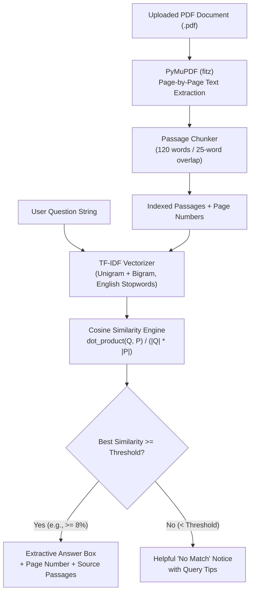

# 📄 AI PDF Question-Answering Assistant

> A fast, transparent, and 100% local Question-Answering assistant for PDF documents built with **Python 3.13**, **Streamlit**, **PyMuPDF**, and **scikit-learn (TF-IDF & Cosine Similarity)**.

Designed specifically for **B.Tech AI & ML students and Python beginners**, this project demonstrates the foundations of **Information Retrieval (IR)** and extractive document search — **without requiring paid API keys, external servers, or generative LLMs**.

---

## 🌟 Key Features

- **📂 Local PDF Ingestion**: Upload any native digital PDF from your computer directly through a clean web UI.
- **📄 Page-Level Provenance**: Extracts text page-by-page using PyMuPDF and tracks exact page numbers for every extracted fact.
- **✂️ Context-Preserving Passage Chunker**: Breaks multi-page documents into 120-word passages with a 25-word sliding overlap, preventing facts from being truncated across boundaries.
- **🔍 Pure Mathematical Retrieval (TF-IDF + Cosine Similarity)**: Converts passages into vector space representations and scores questions using cosine angle similarity.
- **🎯 Extractive Answers & Confidence Scoring**: Extracts the most relevant sentences and displays a percentage match score (e.g., 78.4% confidence).
- **🛡️ 100% Hallucination-Free**: Answers come strictly from the text in your PDF. If evidence is insufficient, it transparently warns you instead of fabricating an answer.
- **🧪 Built-in Sample Document**: Includes a 4-page educational overview of Artificial Intelligence and Machine Learning ready to test in 1 click.
- **🔄 Instant Reset**: Reset the uploaded document, index, and query history with a single button.
- **📖 Page-by-Page Document Inspector**: Review extracted text page by page to verify data integrity.

---

## 🏗️ Architecture & How It Works



### The 4 Pipeline Steps:
1. **Extraction**: `PyMuPDF` reads the raw PDF bytes in memory and parses text per page while checking for encryption or empty/scanned documents.
2. **Chunking**: `split_into_passages` applies a sliding window of 120 words with 25 words overlap to generate manageable passages mapped to their original page.
3. **Vectorization**: `scikit-learn`'s `TfidfVectorizer` computes TF-IDF weights:
   $$\text{TF-IDF}(t, d, D) = \text{TF}(t, d) \times \text{IDF}(t, D)$$
   where Term Frequency (TF) counts term occurrences and Inverse Document Frequency (IDF) scales down ubiquitous words.
4. **Ranking**: `cosine_similarity` compares the question vector against all chunk vectors, outputting a similarity score between `0.0` and `1.0`.

---

## 📁 Project Structure

```text
AI-PDF-Assistant/
├── .streamlit/
│   └── config.toml           # Streamlit headless configuration
├── sample_ai_overview.pdf    # 4-page educational sample PDF for quick testing
├── qa_engine.py              # Pure Python modular QA engine (Extraction, Chunking, TF-IDF)
├── app.py                    # Streamlit web application & user interface
├── test_app.py               # Comprehensive automated test suite (12 tests)
├── create_sample_pdf.py      # Script that generates sample_ai_overview.pdf
├── requirements.txt          # Python dependencies
├── .gitignore                # Git ignore patterns for venv, caches, and OS files
└── README.md                 # Complete project documentation and interview guide
```

---

## ⚙️ Installation & Setup Guide

### 1. Prerequisites
- **Python 3.10 to 3.13** installed on your system.
- Check your Python version in terminal or PowerShell:
  ```powershell
  python --version
  ```

### 2. Clone or Navigate to the Project Folder
```powershell
cd c:\Users\nairo\OneDrive\Documents\AI-PDF-Assistant
```

### 3. (Optional but Recommended) Create a Virtual Environment
```powershell
# Create virtual environment
python -m venv venv

# Activate on Windows (PowerShell)
.\venv\Scripts\Activate.ps1

# Or activate on Windows (Command Prompt)
.\venv\Scripts\activate.bat

# Or activate on macOS/Linux
source venv/bin/activate
```

### 4. Install Dependencies
```powershell
pip install -r requirements.txt
```

---

## 🚀 Running the Application

Start the web application by running:
```powershell
python -m streamlit run app.py
```

Streamlit will print the local URL:
```text
Local URL: http://localhost:8501
Network URL: http://...
```
Open `http://localhost:8501` in your web browser.

---

## 🧪 Quick Test Drive with Sample PDF

1. Launch the app (`python -m streamlit run app.py`).
2. In the left sidebar, click the **"🧪 Load Sample AI Overview PDF"** button.
3. Try asking any of these sample questions:
   - *"What is supervised learning and what are examples?"* $\rightarrow$ **Page 1**
   - *"What is the role of ReLU and Backpropagation?"* $\rightarrow$ **Page 2**
   - *"How do TF-IDF and Cosine Similarity work?"* $\rightarrow$ **Page 3**
   - *"What is the difference between Precision and Recall?"* $\rightarrow$ **Page 4**
4. Observe the **Relevance Score**, the **Source Page citation**, and expand the passage cards to read full contextual evidence.
5. Try an irrelevant question like *"How to bake a chocolate cake?"* to verify that the app flags insufficient evidence instead of making things up.

---

## 🧪 Running the Automated Test Suite

To run the unit and integration tests:
```powershell
python test_app.py
```

### Verified Test Cases:
| Test ID | Test Description | Status |
|---|---|---|
| `test_01` | Multi-page text extraction & 1-indexed page numbering | ✅ PASSED |
| `test_02` | Whitespace sanitization & non-breaking space cleanup | ✅ PASSED |
| `test_03` | Passage chunking, word counting & metadata preservation | ✅ PASSED |
| `test_04` | Question retrieval on Page 1 (Supervised Learning) | ✅ PASSED |
| `test_05` | Question retrieval on Page 2 (ReLU & Backpropagation) | ✅ PASSED |
| `test_06` | Question retrieval on Page 3 (TF-IDF & Cosine Similarity) | ✅ PASSED |
| `test_07` | Question retrieval on Page 4 (Precision & Recall) | ✅ PASSED |
| `test_08` | Irrelevant query rejection (Threshold check) | ✅ PASSED |
| `test_09` | Empty & whitespace-only query validation | ✅ PASSED |
| `test_10` | 0-byte or corrupted PDF exception handling | ✅ PASSED |
| `test_11` | Scanned/textless PDF detection (`has_text=False`) | ✅ PASSED |
| `test_12` | Best extractive answer snippet keyword scoring | ✅ PASSED |

---

## ⚖️ Why Extractive QA vs. Generative LLMs?

| Feature | Extractive QA (This Project) | Generative LLM (ChatGPT / Claude) |
|---|---|---|
| **Cost** | 100% Free (Zero API bills) | Requires paid API credits or heavy GPUs |
| **Hallucination Risk** | **0%** — Answers are direct citations | Can generate convincing but false statements |
| **Privacy** | Complete — Document never leaves your computer | Text is transmitted to third-party cloud servers |
| **Determinism** | 100% deterministic mathematical scoring | Non-deterministic sampling |
| **Speed** | Sub-millisecond vector math | 1 to 5 seconds per streaming response |
| **Synthesizing Summaries** | Extracts best matching sentences | Can rewrite and synthesize in different styles |

---

## ⚠️ Known Limitations

1. **Scanned / Image PDFs**: PyMuPDF extracts native digital text. If a PDF consists purely of scanned photocopies without an OCR layer, no text can be extracted. The app detects this and advises the user.
2. **Vocabulary Mismatch (Synonyms)**: TF-IDF relies on exact keyword overlap (unigrams and bigrams). If the document says *"automobile"* and the query says *"car"*, TF-IDF will not detect similarity unless both words appear in the document.
3. **Complex Cross-Page Reasoning**: Extractive systems locate specific passages. Questions requiring multi-step synthesis across 10 different pages require multi-hop reasoning.

---

## 🔮 Future Enhancements (Roadmap)

- [ ] **Dense Vector Embeddings**: Integrate `sentence-transformers` (e.g., `all-MiniLM-L6-v2`) for semantic similarity beyond exact keywords.
- [ ] **OCR Support**: Add `pytesseract` or `easyocr` to read scanned documents and images.
- [ ] **Local Small LLM**: Plug in Ollama (`llama3:8b` or `phi-3`) for local generative summarization on top of the retrieved passages (RAG architecture).
- [ ] **Multi-Document Comparison**: Allow querying across a folder of multiple PDFs simultaneously.

---

## 🎓 Fresher Interview Cheatsheet

### 1. How would you introduce this project in an interview?
> *"I built a local AI PDF Question-Answering Assistant using Python, Streamlit, PyMuPDF, and Scikit-Learn. It parses multi-page PDF documents, chunks text with sliding-window overlap to retain context, and builds a TF-IDF vector space model. When a user asks a question, the app computes Cosine Similarity between the query vector and passage vectors to extract the top-matching evidence with exact page citations. Because it uses extractive information retrieval rather than a generative LLM, it is 100% free, runs locally, guarantees zero hallucinations, and provides verifiable page provenance."*

### 2. Why did you use PyMuPDF instead of PyPDF2 or PDFMiner?
> *"PyMuPDF (built on MuPDF C-library) is significantly faster — often 10x to 20x faster than pure-Python PDF parsers. It accurately preserves page numbering, handles complex font encodings, and provides clean text extraction with bounding boxes if needed."*

### 3. How does TF-IDF find the right passage?
> *"Term Frequency measures how frequently a query word appears in a specific passage. Inverse Document Frequency down-weights ubiquitous English words that appear across all passages (like 'the', 'is', 'system') and up-weights discriminative terms (like 'backpropagation' or 'precision'). When we compute the cosine similarity between the query vector and passage vectors, passages with high concentrations of the rare query terms score highest."*

---

## 📄 License
This project is open-source and available under the **MIT License**.
